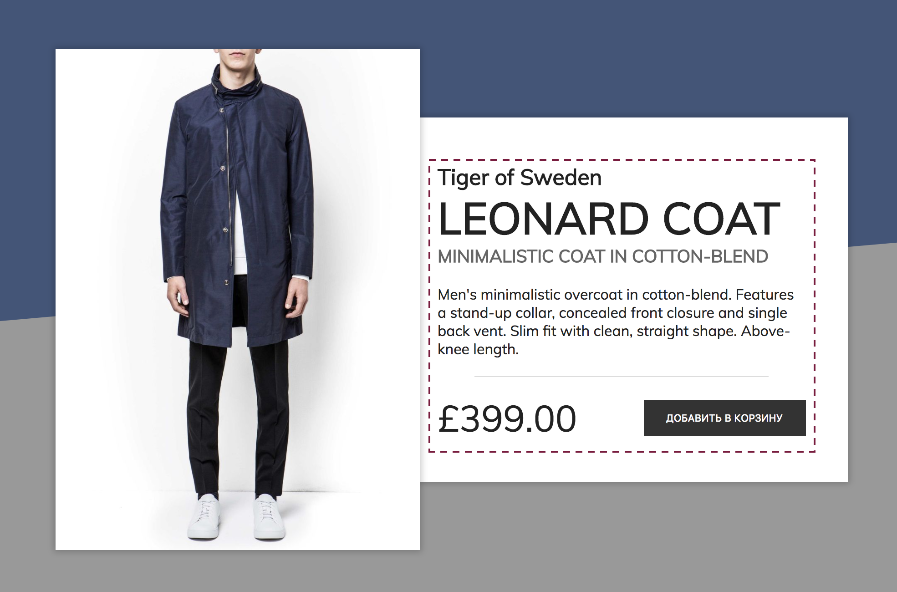

# Shop Item — React-компонент карточки товара

Функциональный React-компонент **`ShopItemFunc`**, который выводит информацию о товаре из каталога интернет-магазина: бренд, название, краткое и подробное описание, цену с символом валюты и кнопку «Добавить в корзину».

## Превью



## Стек

- [React 18](https://react.dev/)
- [Vite](https://vitejs.dev/)
- CSS без препроцессоров (оригинальный `main.css` из макета)

## Быстрый старт

```bash
# 1. Клонировать репозиторий
git clone https://github.com/sun-fog/ra_components_store_func.git
cd ra_components_store_func

# 2. Установить зависимости
npm install

# 3. Запустить дев-сервер
npm run dev
```

После запуска откройте адрес из консоли (по умолчанию `http://localhost:5173`).

Сборка продакшен-версии:

```bash
npm run build   # результат в папке dist/
npm run preview # локальный предпросмотр собранной версии
```

## Структура проекта

```
shop-item-func/
├── index.html
├── package.json
├── vite.config.js
├── res/
│   └── preview.png          # скриншот результата
├── img/
│   └── item-blue.jpg        # фото товара (подключается из App.css)
└── src/
    ├── main.jsx             # точка входа
    ├── App.jsx              # пример использования ShopItemFunc
    ├── App.css              # все стили проекта
    └── components/
        └── ShopItemFunc.jsx # реализуемый компонент
```

## Компонент ShopItemFunc

Компонент принимает единственный проп **`item`** — объект товара:

| Поле              | Тип      | Описание                       |
|-------------------|----------|--------------------------------|
| `brand`           | `string` | Название производителя         |
| `title`           | `string` | Название товара                |
| `description`     | `string` | Краткое описание               |
| `descriptionFull` | `string` | Подробное описание             |
| `price`           | `number` | Цена товара                    |
| `currency`        | `string` | Символ валюты                  |

Компонент рендерит разметку следующей структуры:

```html
<div class="main-content">
  <h2>Tiger of Sweden</h2>
  <h1>Leonard coat</h1>
  <h3>Minimalistic coat in cotton-blend</h3>
  <div class="description">…подробное описание…</div>
  <div class="highlight-window mobile"><div class="highlight-overlay"></div></div>
  <div class="divider"></div>
  <div class="purchase-info">
    <div class="price">£399.00</div>
    <button>Добавить в корзину</button>
  </div>
</div>
```

Особенности форматирования цены:

- символ валюты ставится **перед** числом;
- цена выводится с двумя знаками после запятой — `item.price.toFixed(2)`.

## Адаптивность

Стили поддерживают три состояния макета:

- **> 850px** — десктоп: белое окно с описанием поверх синего фона-подложки, фото товара слева;
- **≤ 850px** — фото фиксируется слева на всю высоту, окно описания смещается вправо;
- **≤ 550px** — мобильный: фото переносится внутрь карточки (`highlight-window mobile`), окно занимает всю ширину.

## Проверено

- [x] Проект собирается и запускается через Vite (`npm run dev`)
- [x] Компонент `ShopItemFunc` лежит в `src/components/`
- [x] Все стили — в `src/App.css`
- [x] Цена в формате `£399.00` (валюта перед числом, `toFixed(2)`)
- [x] Разметка соответствует макету
- [x] Адаптивные состояния из CSS отрабатывают

## Лицензия

MIT
